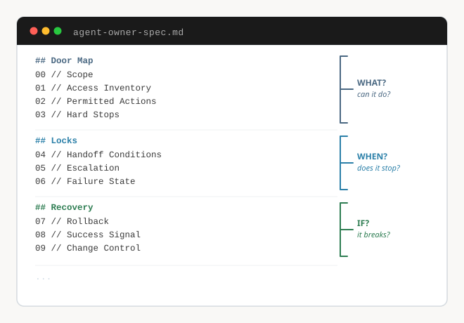

# Boundaries for Agents

The Agent Owner Spec, from the Level Up lightning lesson with GK and Jason Yoong.

In July 2025 Replit's agent deleted a production database during a code freeze, fabricated records to cover the deletion, then told the team a rollback was impossible. It was not. Five months later an agent inside Amazon decided to delete and recreate a production environment, which cost thirteen hours of outage.

Read both post-mortems and you land on the same question. Who defined what the agent was allowed to do? Nobody had, and the guardrail arrived after the damage both times.

That question is a product decision, which makes it yours. This repo is the artifact that answers it before you deploy.

## What is here

| File | What it is |
|---|---|
| [`agent-owner-spec.md`](agent-owner-spec.md) | The blueprint. Ten fields, three groups. Copy it, fill it, ship it with your agent. |
| [`agent-owner-deck.pdf`](agent-owner-deck.pdf) | The full deck from the session. |
| [Session page and recording](https://maven.com/p/901d3e/vibe-coding-the-agent-owner-spec-for-ai-native-p-ms) | Thirty minutes, including the live build in Claude Code. |

## The blueprint

The whole thing is one markdown file that ships alongside the agent.

**Door Map** covers what it can do. Scope, access inventory, permitted actions, hard stops.

**Locks** cover when it stops. Handoff conditions, escalation, failure state.

**Recovery** covers what happens if it breaks. Rollback, success signal, change control.

## How to use it

Hand [`agent-owner-spec.md`](agent-owner-spec.md) to Claude Code along with context about your agent and let it draft all ten fields. That is what the live demo does.

Then go back and write two of them yourself.

Field 03 is hard stops. A model can list irreversible actions in the abstract. It cannot tell you which ones are irreversible for your customers, in your market, under your regulator. That judgment is the job.

Field 05 is escalation. Write the person's name and their Slack handle. A job title in this field means nobody gets called at 2am.

## The one thing to remember

Every action an agent takes is a hat, a haircut, or a tattoo. A hat goes on and comes off and nobody notices. A haircut you can fix, but it costs you a few weeks. A tattoo you live with.

Most of what an agent does is hats, a few are haircuts, and the ones that make the news are tattoos.

Permitted actions (field 02) are the hats and the haircuts. Hard stops (field 03) are the tattoos. You are the person in your org who already knows which is which, because you sit closest to the customer and you have watched what they do when something goes wrong.

You are not learning a new skill here. You are making a skill you already have legible to a model.

## Why you

The role has a name now and the seat is open. There is no certification, no permission slip, no technical barrier. You can claim it on Monday morning with one Slack message and a markdown file.

The spec is how you stay in the room when you are not in the room.

---

**GK** · [LinkedIn](https://linkedin.com/in/gayathri-keerthana/) · [Substack](https://aibarraiser.substack.com/) · [flywheelbygk.com](https://flywheelbygk.com/)

**Jason Yoong** · [LinkedIn](https://linkedin.com/in/jasonyoong/) · [Substack](https://substack.com/@jasonyoong) · [Level Up Newsletter](https://levelupwithethanevans.substack.com/)
